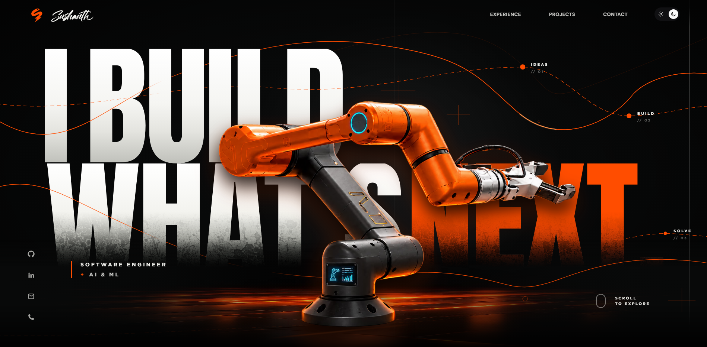
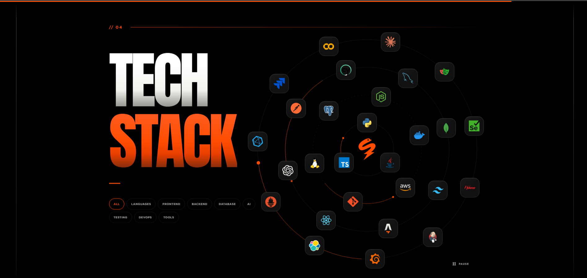
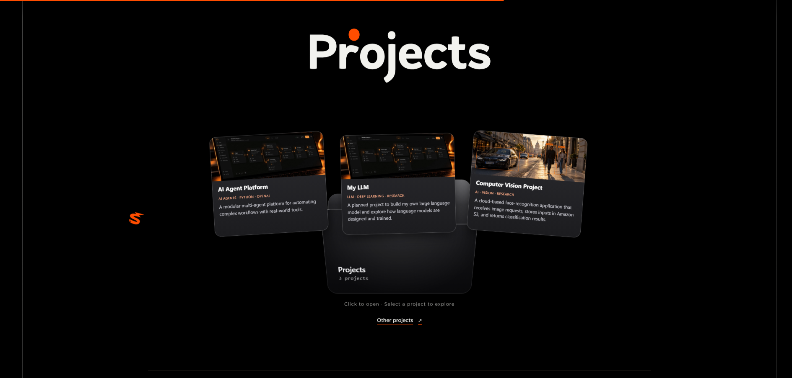
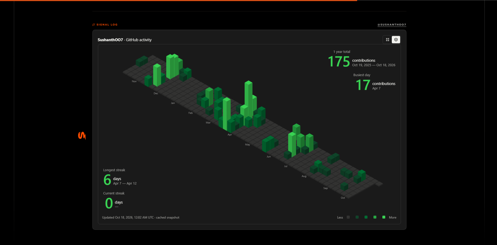
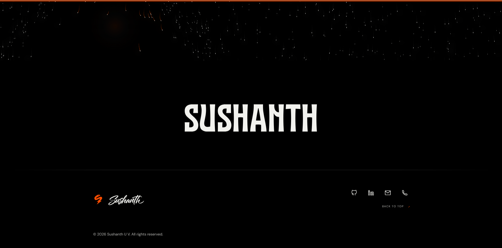

<p align="center">
  
</p>

<h1 align="center">Sushanth U V — Personal Portfolio</h1>

<p align="center">
  A personal portfolio showcasing my experience, projects, technical skills, and GitHub activity.
  Built with Astro, React, and animated interactions, and deployed on Cloudflare Workers.
</p>

<p align="center">
  <a href="https://sushanth.tech">View Live Portfolio</a> ·
  <a href="#website-previews">Website Previews</a> ·
  <a href="#install--run">Run Locally</a>
</p>

## Tech Stack

The technologies used to build this portfolio, with the same logos used on the site.

<p>
  <a href="https://astro.build/"></a>&nbsp;
  <a href="https://react.dev/"></a>&nbsp;
  <a href="https://www.typescriptlang.org/"></a>&nbsp;
  <a href="https://tailwindcss.com/"></a>&nbsp;
  <a href="https://nodejs.org/"></a>
</p>

- **Astro** — static pages and React island integration.
- **React & TypeScript** — interactive components and typed application code.
- **CSS & Tailwind CSS** — responsive layouts, styling, and utilities.
- **Node.js & Vite** — development and build tooling.
- **Cloudflare Workers & Wrangler** — hosting and deployment.

## Website Previews

### Home



### Tech Stack



### Projects



### GitHub Activity



### Footer & Contact



## Resources Used

### Libraries & Tools

- [Astro](https://astro.build/) and [Astro React](https://docs.astro.build/en/guides/integrations-guide/react/) — site framework and React integration.
- [React](https://react.dev/) — interactive UI components.
- [GSAP](https://gsap.com/) and [Motion](https://motion.dev/) — animations and transitions.
- [Lenis](https://lenis.darkroom.engineering/) — smooth scrolling.
- [Lottie Web](https://github.com/airbnb/lottie-web) — SVG animation playback.
- [Tailwind CSS](https://tailwindcss.com/) — styling utilities.
- [Vite](https://vite.dev/) and [TypeScript](https://www.typescriptlang.org/) — tooling and type checking.
- [Vitest](https://vitest.dev/) and [Playwright](https://playwright.dev/) — automated testing.
- [Wrangler](https://developers.cloudflare.com/workers/wrangler/) — Cloudflare development and deployment.

### AI Assistance

<p>
  <a href="https://chatgpt.com/"></a>
</p>

[ChatGPT](https://chatgpt.com/) — AI assistance during development and documentation.

### Icons & Images

- Technology logos are reused from [`public/images/tech`](public/images/tech). See the [artwork credits and licenses](public/images/tech/NOTICE.md).
- Social icons reuse the SVG paths from the site's [`SocialLinks.astro`](src/components/astro/SocialLinks.astro) component.
- Portfolio screenshots are stored in [`public/images/readme`](public/images/readme).

## Connect With Me

<p>
  <a href="https://github.com/SushanthOO7"></a>&nbsp;&nbsp;
  <a href="https://www.linkedin.com/in/sushanth-u-v-7899911a7"></a>&nbsp;&nbsp;
  <a href="mailto:sushanth.2942000@gmail.com"></a>&nbsp;&nbsp;
  <a href="tel:+917022883568"></a>
</p>

[GitHub](https://github.com/SushanthOO7) · [LinkedIn](https://www.linkedin.com/in/sushanth-u-v-7899911a7) · [Email](mailto:sushanth.2942000@gmail.com)

## Install & run

Use Node.js `22.22.0` or newer. Install the locked dependencies with:

```bash
npm ci
```

Once it's done start up a local server with:

```bash
npm run dev
```

### GitHub contribution skyline

The Projects section reads `SushanthOO7` contribution data from GitHub's GraphQL API during the Astro build. Copy `.env.example` to `.env` and set a read-only `GITHUB_TOKEN` to use fresh data locally. The token stays server-side and must not use Astro's `PUBLIC_` prefix.

Refresh the checked-in fallback snapshot explicitly with:

```bash
npm run github:refresh
```

Without a token, builds use `src/data/github-contributions.json`. In Cloudflare, configure `GITHUB_TOKEN` as an encrypted build environment variable (not a browser/runtime variable) so production builds can refresh the chart; keep the snapshot committed so API or rate-limit failures do not block deployment.

## Deployment

Before deployment, run the security checks and production dependency audit:

```bash
npm run security:check
npm run security:audit
PUBLIC_SITE_URL=https://sushanth.tech npm run build:production
```

Cloudflare should install with `npm ci` and build with `npm run build:production`. Configure `GITHUB_TOKEN` only as an optional encrypted, read-only build secret. The deployed site has no contact API or form handler: its contact links open the visitor's email or phone application.

See the [security model and control register](docs/security.md) and the [Cloudflare deployment security checklist](docs/deployment-security-checklist.md) before changing hosting, adding credentials, or introducing server-side features.

---

<p align="center">© 2026 Sushanth U V. All rights reserved.</p>
